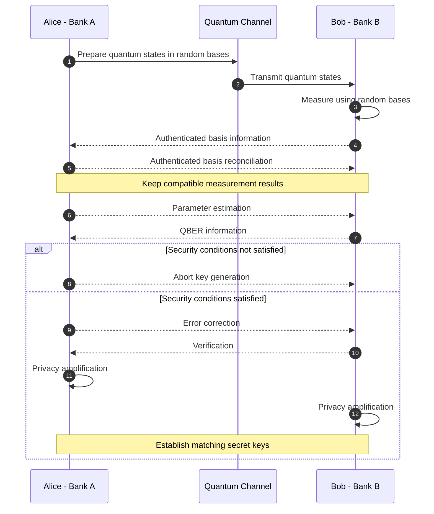
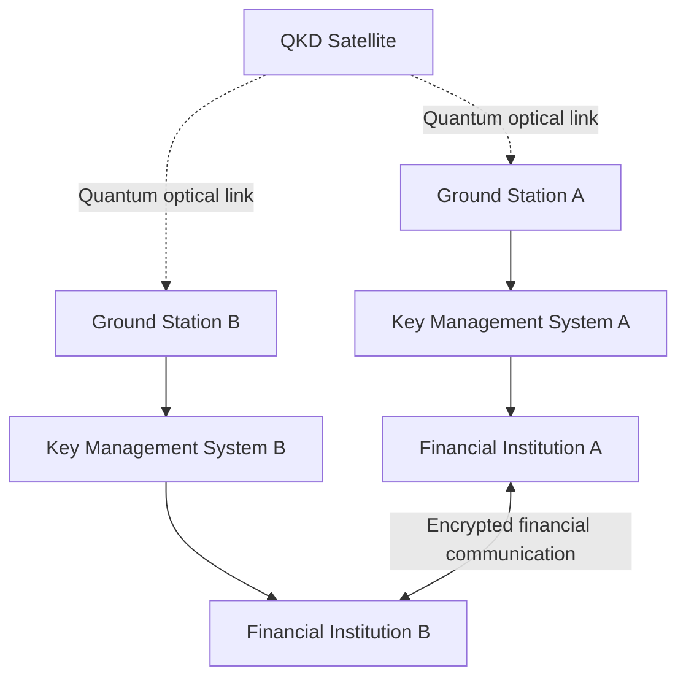
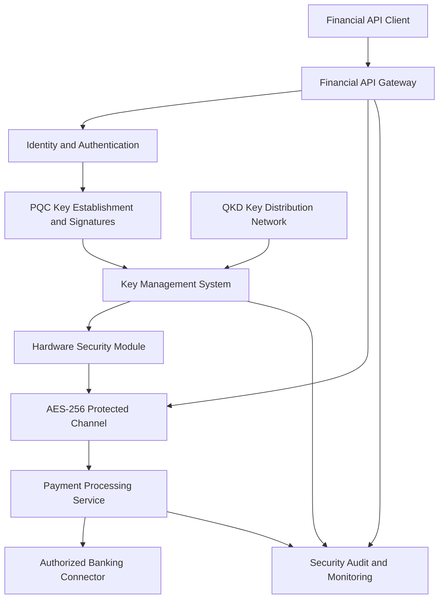
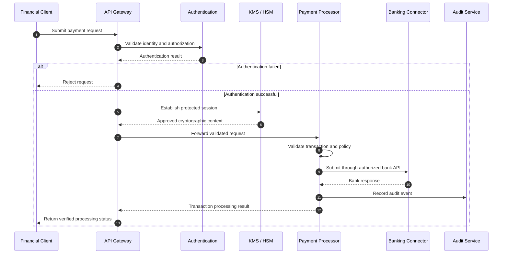

# 🔐 QKD Financial Infrastructure

<p align="center">
  
</p>

<p align="center">
  
  
  
  
</p>

<p align="center">
  
  
  
  
  
</p>

---

## 📖 Overview

**QKD Financial Infrastructure** is a technical research project exploring Quantum Key Distribution (QKD), Post-Quantum Cryptography (PQC), and their potential integration into secure financial infrastructure.

The project focuses on:

- Quantum physics principles
- Quantum key distribution protocols
- Quantum-resistant financial communication
- Satellite-based quantum communication
- Hybrid QKD-PQC security architecture
- Open Banking and financial APIs
- Interbank communication
- Payment gateways and settlement infrastructure

> **Research scope:** This repository focuses on scientific QKD and standardized PQC technologies. It does not promote speculative Quantum Financial System (QFS) narratives.

> **Project status:** Research and conceptual architecture only. No production QKD deployment, bank integration, or security certification is claimed.

---

## 🎯 Focus Areas

| Area | Description |
|------|-------------|
| Physics Principles | No-cloning theorem, quantum measurement, disturbance detection |
| QKD Protocols | BB84, E91, CV-QKD, MDI-QKD |
| Financial Applications | Banking infrastructure and protected interbank links |
| Case Studies | Publicly reported QKD and quantum-safe networking initiatives |
| Satellite QKD | QEYSSat and QKDSat-related research |
| Hybrid Security | QKD, ML-KEM, ML-DSA, SLH-DSA, AES-256 |
| API Security | Open Banking, financial gateways, authentication |
| Settlement Systems | Secure communications for payment and settlement workflows |

---

## 🧠 Why Quantum Key Distribution?

Traditional public-key cryptography commonly relies on mathematical problems that are difficult for classical computers.

Cryptographically relevant quantum computers could threaten widely deployed RSA and elliptic-curve cryptography through Shor's algorithm.

This creates the potential for:

**Harvest Now, Decrypt Later (HNDL)**

An attacker may capture encrypted information today and attempt to decrypt it in the future.

QKD addresses a different security problem: establishing shared secret key material using quantum communication and authenticated classical communication.

### Fundamental Principles

**1. No-Cloning Theorem**

An unknown quantum state cannot be perfectly copied.

**2. Measurement Disturbance**

Certain interception strategies introduce detectable changes in transmitted quantum states.

**3. Quantum Bit Error Rate**

QKD participants estimate the quantum bit error rate (QBER) to assess whether secure key extraction is feasible.

**4. Privacy Amplification**

Classical post-processing reduces an adversary's potential information about the final key.

**5. Authenticated Communication**

QKD requires an authenticated classical channel to prevent impersonation and man-in-the-middle attacks.

> QKD is not an encryption algorithm. It distributes secret key material. Encryption is performed separately using symmetric cryptography such as AES-256.

---

## 🔬 BB84 Quantum Key Distribution



A QBER near 11% is a commonly discussed asymptotic threshold for certain idealized BB84 security models. Practical thresholds depend on protocol, finite-key analysis, device characteristics, and security assumptions.

---

## 🏦 Financial Infrastructure Applications

### 1. Interbank Communication

QKD may support the protection of selected high-value communication links between financial institutions.

Potential use cases include:

- Interbank network encryption
- Data center interconnection
- Financial messaging transport
- Secure disaster recovery links
- High-confidentiality financial infrastructure

### 2. Payment Gateway Infrastructure

A conceptual financial security architecture may include:

- API Gateway
- OAuth 2.0 / OpenID Connect
- TLS with post-quantum key establishment
- Hardware Security Modules
- Transaction processing services
- Audit logging
- Key Management Systems

### 3. SWIFT and ISO 20022

QKD and PQC may be evaluated as additional security mechanisms for communication infrastructure supporting:

- SWIFT connectivity
- ISO 20022 messages
- Payment processing
- Interbank reconciliation
- Clearing and settlement

QKD does not itself execute transfers, authorize transactions, generate bank balances, or settle funds.

---

## 🛰️ Satellite Quantum Key Distribution

Satellite QKD is being researched to address geographic limitations of terrestrial quantum communication.

Research programs include:

- QEYSSat - Canada
- QKDSat-related initiatives - Europe
- Satellite-to-ground optical quantum communication
- Trusted-node and future quantum-network architectures

### Satellite Architecture



This is a conceptual trusted-satellite architecture, not an implementation claim. Security depends on satellite trust assumptions, ground-station security, authentication, and key-management design.

---

## 🔐 Hybrid QKD-PQC Framework

QKD and PQC solve related but distinct cryptographic problems.

| Security Layer | Technology | Primary Function |
|----------------|------------|------------------|
| Quantum Channel | QKD | Secret key establishment |
| Key Establishment | ML-KEM | Post-quantum key encapsulation |
| Digital Signatures | ML-DSA / SLH-DSA | Post-quantum signatures |
| Data Encryption | AES-256 | Symmetric data protection |
| Key Management | KMS / HSM | Key storage, lifecycle, and access control |
| API Security | TLS / mTLS | Protected application communications |
| Financial Application | Payment Gateway | Authorized transaction processing |
| Monitoring | SIEM / Audit Logs | Security monitoring and accountability |

**Important:** ML-KEM is a key encapsulation mechanism, not a digital signature algorithm. ML-DSA and SLH-DSA are standardized signature algorithms.

### Hybrid Architecture



QKD and PQC key material may be combined through a carefully analyzed key-combining mechanism. Simply concatenating keys without a defined security construction is not sufficient.

---

## 🔄 End-to-End Financial Transaction Flow



The diagram represents a proposed architecture. Actual payment execution requires authorized banking access, regulatory compliance, and a valid banking integration.

---

## 📂 Repository Structure

```text
qkd-financial-infrastructure/
├── README.md
├── LICENSE
├── .gitignore
├── paper/
│   ├── 01-introduction.md
│   ├── 02-theory.md
│   ├── 03-implementation.md
│   ├── 04-hybrid-framework.md
│   └── 05-conclusion.md
├── references/
│   └── bibliography.bib
└── diagrams/
    ├── bb84-flow.mmd
    ├── satellite-qkd.mmd
    ├── hybrid-arch.mmd
    └── transaction-flow.mmd
```

---

## ⚠️ Limitations and Open Challenges

### Physical Infrastructure

QKD typically requires specialized optical communication equipment and suitable quantum channels.

### Distance

Optical fiber losses constrain practical terrestrial QKD distances. Satellite systems and trusted nodes introduce additional engineering and trust considerations.

### Authentication

QKD requires authenticated classical communications and cannot replace identity verification or digital signatures.

### Implementation Security

Practical QKD devices may suffer from side-channel attacks, detector vulnerabilities, calibration errors, and implementation flaws.

### Scalability

Deployment cost, network topology, operational complexity, and integration with existing infrastructure remain major challenges.

### Regulatory Compliance

Financial infrastructure must meet applicable security, privacy, operational, and regulatory requirements.

---

## 📚 Research References

### NIST Post-Quantum Cryptography

- FIPS 203 - ML-KEM
- FIPS 204 - ML-DSA
- FIPS 205 - SLH-DSA

### Quantum Cryptography

- Bennett and Brassard - BB84
- Ekert - Quantum cryptography based on Bell's theorem
- Scarani et al. - The security of practical quantum key distribution
- Pirandola et al. - Advances in quantum cryptography

### Additional Research Areas

- ETSI Quantum Key Distribution standards
- Satellite quantum communication
- Financial network cryptographic migration
- Hybrid QKD and PQC integration

The bibliography includes foundational references. Reported commercial deployments and recent case studies require independent source verification before being presented as established facts.

---

## 🛡️ Security and Research Disclaimer

This repository is intended for educational, research, and conceptual system-design purposes.

It does not provide:

- Access to banking networks
- Bank transfer authorization
- SWIFT transaction execution
- Production quantum hardware
- Guaranteed quantum security
- Financial settlement services

All production implementations require independent security assessment and appropriate institutional authorization.

---

## ☕ Support the Project

If this project supports your learning, research, or development, consider supporting its continued development.

<p align="center">
  <a href="https://www.paypal.com/paypalme/bungtempong99">
    
  </a>
</p>

---

## 👨‍💻 Maintainer

**Kongali1720**

GitHub: https://github.com/kongali1720

Project: QKD Financial Infrastructure

**Research • Quantum Security • Financial Technology**

---

## 📜 License

MIT License.

Copyright (c) 2026 Kongali1720.

---

# 🏗️ System Engineering Documentation

The project includes an expanded implementation blueprint covering financial software engineering, transaction processing, banking connectivity, cryptographic infrastructure and operational readiness.

## Documentation Index

| Document | Subject |
|----------|---------|
| [00 Project Charter](docs/00-project-charter.md) | Vision, scope and governance |
| [01 Requirements](docs/01-system-requirements.md) | Functional and non-functional requirements |
| [02 Architecture](docs/02-system-architecture.md) | Complete system architecture |
| [03 Infrastructure](docs/03-infrastructure-design.md) | Server, network and deployment topology |
| [04 Transaction Lifecycle](docs/04-transaction-lifecycle.md) | Financial transaction states and processing |
| [05 Payment Engine](docs/05-payment-engine.md) | Payment orchestration and idempotency |
| [06 Double-Entry Ledger](docs/06-double-entry-ledger.md) | Accounting and journal integrity |
| [07 API Specification](docs/07-api-specification.md) | API endpoints and request contracts |
| [08 Banking Integration](docs/08-banking-integration.md) | Bank API and host-to-host integration |
| [09 QKD-PQC](docs/09-qkd-pqc-implementation.md) | Quantum-safe security implementation |
| [10 Database Design](docs/10-database-design.md) | Data models and integrity |
| [11 Software Engineering](docs/11-software-engineering.md) | Backend development and coding standards |
| [12 Security](docs/12-security-compliance.md) | Application security and compliance |
| [13 DevOps](docs/13-devops-deployment.md) | CI/CD and infrastructure deployment |
| [14 Testing](docs/14-testing-validation.md) | Financial and security testing |
| [15 Operations](docs/15-monitoring-operations.md) | Monitoring and incident management |
| [16 Disaster Recovery](docs/16-disaster-recovery.md) | Backup and recovery |
| [17 Roadmap](docs/17-implementation-roadmap.md) | Phased implementation plan |
| [18 Risk Register](docs/18-risk-register.md) | Project and operational risks |
| [19 Acceptance Criteria](docs/19-acceptance-criteria.md) | Delivery and production gates |

## Engineering Diagrams

- [Financial System](diagrams/financial-system.mmd)
- [Software Engineering Lifecycle](diagrams/software-engineering.mmd)
- [Settlement and Reconciliation](diagrams/settlement-reconciliation.mmd)

## Implementation Philosophy

Build and validate the conventional financial software foundation first.

Introduce post-quantum cryptography through supported implementations and evaluate QKD separately through laboratory research.

Production financial operations require authorized provider access, appropriate legal permissions, security assessment and formal operational approval.

---

## Investor Documentation

The following materials are preliminary planning documents for the
Kongali Financial Infrastructure Platform (KFIP) proposed within
PT FAM TIMUR INDONESIA.

- [Corporate Structure and Governance](docs/20-corporate-structure-fam.md)
- [Investor Due Diligence Checklist](docs/21-investor-due-diligence.md)
- [Preliminary Investment Term Sheet](docs/22-investment-term-sheet.md)
- [Detailed Investment Budget](docs/23-detailed-investment-budget.md)
- [Investment Milestones and Funding Controls](docs/24-investment-milestones.md)

**Disclaimer:** These documents are drafts for discussion and planning.
They are not a securities offering, legal opinion, audited financial
projection, or binding investment commitment. All figures and assumptions
require validation and professional review.
