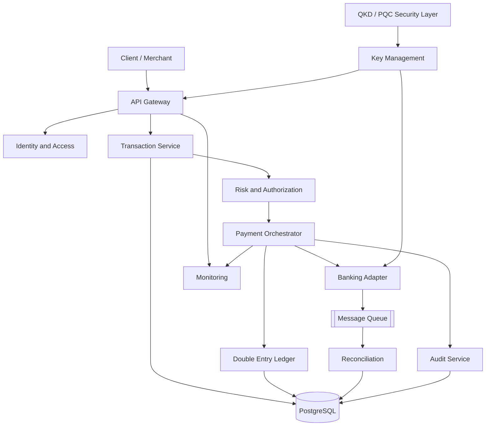

# 02 - SYSTEM ARCHITECTURE

## 1. Architecture Style

Recommended initial architecture:

Modular Monolith + Asynchronous Workers.

This is preferable to premature microservice decomposition because financial consistency, deployment simplicity and debugging are priorities.

Microservices may be introduced when scaling and independent ownership justify them.

## 2. Logical Components

1. API Gateway
2. Identity and Access Service
3. Customer and Account Service
4. Transaction Service
5. Risk and Authorization Service
6. Payment Orchestrator
7. Ledger Service
8. Banking Adapter Layer
9. Reconciliation Service
10. Notification Service
11. Audit Service
12. Key Management Integration
13. Monitoring and Observability

## 3. High-Level Architecture

## 4. Trust Boundaries

Boundary A: External clients to API Gateway.

Boundary B: API services to database.

Boundary C: Payment system to external banking provider.

Boundary D: Application services to key management infrastructure.

Boundary E: Administrative interfaces to production infrastructure.

Every boundary must enforce authentication, authorization and appropriate logging.

## 5. Data Flow

1. Client sends transaction instruction.
2. API authenticates client.
3. Request validation is performed.
4. Risk and policy checks are executed.
5. Payment orchestration determines the next action.
6. Ledger entries are created according to transaction accounting rules.
7. Authorized banking connector submits the instruction.
8. Provider response is stored.
9. Reconciliation confirms the final outcome.
10. Audit and monitoring record the lifecycle.

## 6. Design Decisions

- PostgreSQL for initial transactional database.
- Redis only for non-authoritative cache and temporary coordination.
- Durable message broker for asynchronous jobs.
- REST API for initial external integration.
- OpenAPI for API contracts.
- Docker for local development.
- Linux VPS or managed cloud infrastructure for later deployment.

The ledger database remains the authoritative accounting record.
