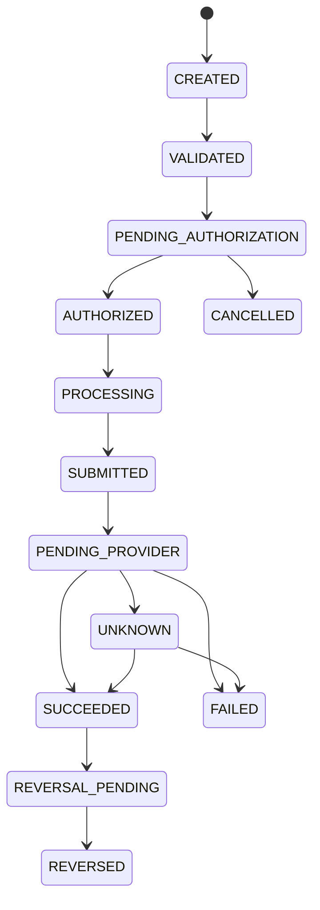

# 04 - FINANCIAL TRANSACTION LIFECYCLE

## 1. Transaction Model

A transaction represents an instruction to move value through an authorized payment mechanism.

A transaction request does not itself prove that funds have moved.

## 2. Transaction States

CREATED
VALIDATED
PENDING_AUTHORIZATION
AUTHORIZED
PROCESSING
SUBMITTED
PENDING_PROVIDER
SUCCEEDED
FAILED
CANCELLED
REVERSAL_PENDING
REVERSED
UNKNOWN

## 3. State Transition Rules

CREATED -> VALIDATED
VALIDATED -> PENDING_AUTHORIZATION
PENDING_AUTHORIZATION -> AUTHORIZED
PENDING_AUTHORIZATION -> CANCELLED
AUTHORIZED -> PROCESSING
PROCESSING -> SUBMITTED
SUBMITTED -> PENDING_PROVIDER
PENDING_PROVIDER -> SUCCEEDED
PENDING_PROVIDER -> FAILED
PENDING_PROVIDER -> UNKNOWN
UNKNOWN -> SUCCEEDED or FAILED after provider inquiry
SUCCEEDED -> REVERSAL_PENDING
REVERSAL_PENDING -> REVERSED

Terminal states must not be silently overwritten.

## 4. Transaction Flow

## 5. Processing Sequence

### Step 1 - Request

Client submits:
- Amount
- Currency
- Source account reference
- Destination reference
- Payment purpose
- Idempotency key

### Step 2 - Validation

Check:
- Required fields
- Currency
- Amount precision
- Account status
- Client permissions
- Duplicate requests

### Step 3 - Authorization

Check:
- Available balance or approved funding source
- Transaction limits
- Risk policy
- Required approvals
- Applicable compliance controls

### Step 4 - Execution

Payment orchestrator submits the request to the appropriate adapter.

### Step 5 - Provider Response

Store:
- Provider reference
- Provider status
- Response timestamp
- Sanitized response metadata

### Step 6 - Reconciliation

Compare internal transaction, provider record and settlement evidence.

### Step 7 - Finalization

Only mark a transaction settled when the relevant provider or settlement evidence supports that conclusion.

## 6. Critical Timeout Rule

A timeout does not mean failure.

If a provider may have processed the request, transition to UNKNOWN or PENDING_PROVIDER.

Perform provider inquiry using the original reference before retrying.

Never create a second payment merely because the first response was delayed.
