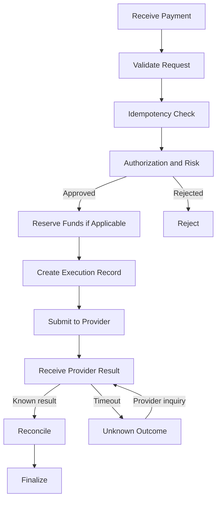

# 05 - PAYMENT ENGINE

## 1. Responsibilities

The payment engine manages:
- Payment instructions
- Routing
- Authorization
- Execution
- Provider communication
- Retry policies
- Status transitions
- Reversals
- Reconciliation triggers

## 2. Core Modules

PaymentController:
Receives API requests.

PaymentService:
Coordinates business rules.

RiskService:
Evaluates policy and limits.

PaymentRouter:
Selects an authorized provider.

BankAdapter:
Implements provider-specific communication.

TransactionRepository:
Persists transaction state.

LedgerService:
Creates accounting entries.

ReconciliationService:
Matches provider outcomes.

## 3. Idempotency

Each payment creation request must include an idempotency key.

The key must be unique within its defined client scope.

Persist:
- Client ID
- Idempotency key
- Request fingerprint
- Transaction ID
- Response snapshot
- Expiry policy

If the same key and same request are received, return the existing result.

If the same key is reused with different material request data, reject it.

## 4. Retry Policy

Retry only operations known to be safe.

- Network failure before submission: retry may be allowed.
- Provider timeout after submission: inquire first.
- Explicit provider rejection: follow provider-specific policy.
- Unknown outcome: do not blindly resubmit.

Use bounded exponential backoff and jitter for retryable operations.

## 5. Payment Orchestration

## 6. Reversal

A reversal is a new compensating financial operation.

Never delete or edit the original journal entries to hide a completed transaction.

## 7. External Provider Independence

Each banking integration must implement a documented adapter contract.

Do not hardcode one provider's response format into the core payment engine.
