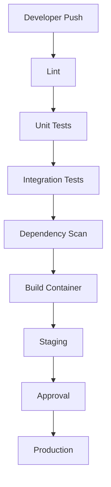

# 13 - DEVOPS AND DEPLOYMENT

## 1. Deployment Strategy

Development:
Docker Compose.

Testing:
Automated CI environment.

Staging:
Production-like isolated environment.

Production:
Approved cloud or dedicated infrastructure.

## 2. Container Services

- API
- PostgreSQL
- Redis
- Worker
- Reverse proxy

## 3. CI Pipeline

## 4. Environment Configuration

Use:
- Environment variables for non-secret configuration.
- Secret manager for credentials.
- Separate keys per environment.
- No production secrets in Git.

## 5. Deployment Controls

- Versioned releases.
- Database migration review.
- Backup before risky migrations.
- Health checks.
- Rollback plan.
- Deployment audit log.
- Approval for production changes.

## 6. Hosting Evolution

Stage 1:
Local WSL development.

Stage 2:
Docker-based staging VPS.

Stage 3:
Managed PostgreSQL and monitored application hosting.

Stage 4:
Redundant production architecture.

Stage 5:
Dedicated security infrastructure and QKD laboratory evaluation.

Shared cPanel hosting is suitable for some websites but is generally not the appropriate foundation for a persistent financial transaction engine requiring private networking, workers, database controls and operational monitoring.
