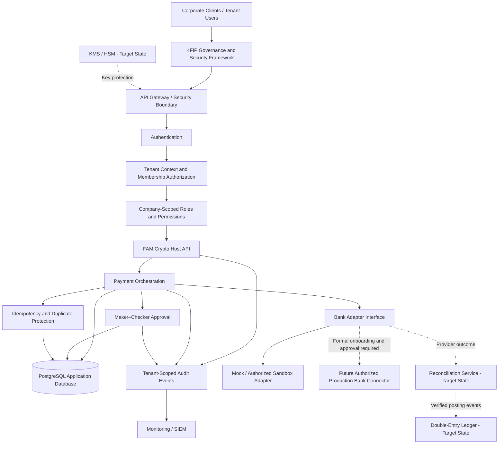
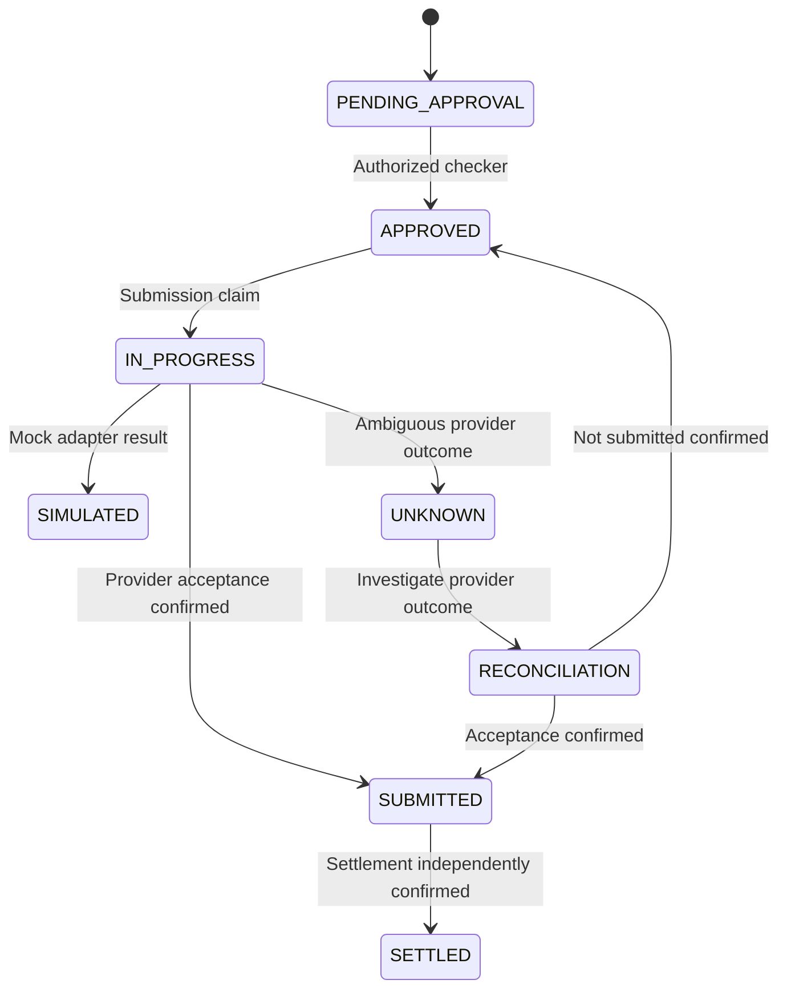

# 25. KFIP – Crypto Host Integration Architecture

**Document Status:** Architecture Proposal
**Version:** 0.2.0
**Project:** Kongali Financial Infrastructure Platform (KFIP)
**Integration Component:** FAM Crypto Host
**Last Updated:** 2026-11-11
**Classification:** Technical Architecture Proposal

---

## 1. Purpose

This document defines the proposed integration architecture between the Kongali Financial Infrastructure Platform (KFIP) and FAM Crypto Host.

KFIP provides the broader financial infrastructure architecture, security framework, governance, and operational standards.

Crypto Host provides the application-level API and payment orchestration implementation.

This document distinguishes implemented capabilities from target-state capabilities. It does not claim that production banking connectivity, bank settlement, a production double-entry ledger, or regulated payment services are currently operational.

## 2. Scope and System Boundaries

### 2.1 Component responsibilities

| Component | Responsibility | Current status |
|---|---|---|
| KFIP | Overall platform architecture, governance, security standards, and integration oversight | Architecture / governance |
| Crypto Host API | Authentication and payment orchestration | Present in source project |
| PostgreSQL | Application persistence | Present |
| Bank Adapter | Connector abstraction for bank submission | Present as application abstraction; live connector not verified |
| Mock Adapter | Simulated bank submission for development/testing | Present |
| Audit Service | Operational event recording | Audit log model present; completeness requires review |
| Security Layer | Authentication, authorization, encryption, and access control | Partial; security review required |
| Ledger Service | Double-entry accounting | Not verified |
| Reconciliation Service | Provider outcome and settlement reconciliation | Not verified |
| Tenant Management | Company and membership lifecycle, tenant-scoped authorization | Target state; not yet implemented |

### 2.2 Explicit non-goals

This architecture is not evidence that:

- A bank has onboarded or authorized the platform.
- A production bank connector is active.
- A payment marked `APPROVED` has been transmitted or settled.
- A mock or simulated response represents movement of funds.
- A production double-entry ledger or reconciliation engine exists.
- QKD or PQC has been deployed in the Crypto Host production environment.

## 3. Proposed Integration Architecture



The diagram represents the target integration architecture. Components labelled target state or future are not claims of current implementation.

## 4. API Integration

The following endpoints are documented in the current Crypto Host API project and must be verified against the deployed application and its reverse-proxy configuration.

| Method | Endpoint | Purpose |
|---|---|---|
| POST | `/api/v1/auth/token` | Obtain access token |
| GET | `/api/v1/payments` | List payments |
| POST | `/api/v1/payments` | Create payment |
| POST | `/api/v1/payments/{payment_id}/approve` | Approve payment |
| POST | `/api/v1/payments/{payment_id}/submit` | Submit payment |
| GET | `/health` | Liveness / health check |
| GET | `/ready` | Readiness check |

### 4.1 API contract requirements

Before production use, each endpoint must define:

- Authentication requirements and token expiry behaviour.
- Company/tenant context resolution.
- Company-scoped authorization and resource ownership checks.
- Request and response schemas, validation rules, and error codes.
- Idempotency behaviour for payment creation and submission.
- Audit events and correlation identifiers.
- Rate limits, payload limits, and abuse controls.
- Versioning and backward-compatibility policy.

The public API prefix may be affected by application routing or reverse-proxy configuration. The deployed route must be verified rather than inferred from documentation alone.

## 5. Multi-Tenant Security Architecture

### 5.1 Tenant model

The target architecture supports multiple companies (tenants). A user may belong to one or more companies. A user's permissions are evaluated in the context of an active company membership.

Proposed core entities:

| Entity | Purpose |
|---|---|
| `companies` | Tenant/company records |
| `company_users` | User-to-company membership, role, and membership status |
| `users` | Global identity and authentication record |
| `beneficiaries` | Beneficiary records owned by a company |
| `payments` | Payment records owned by a company |
| `audit_logs` | Events associated with a company and actor |
| `payment_approvals` | Approval records associated with a payment and approver |
| `bank_submissions` | Submission records associated with a payment |

`company_users` should hold the company-scoped role and membership status. A global `users.role` field must not be treated as sufficient authorization for multi-tenant operations.

`payment_approvals` is the proposed logical entity name. The physical table name must be reconciled with the existing SQLAlchemy model and Alembic migration history before implementation.

### 5.2 Tenant context resolution

For every authenticated request, the application must:

1. Authenticate the user.
2. Resolve the requested company context using a documented mechanism.
3. Verify that the user has an active membership in that company.
4. Load the user's role and permissions from that membership.
5. Apply the company scope to every data access and mutation.
6. Record the company context in the audit event.

A company identifier supplied by a client is a selector, not proof of authorization. The server must independently verify membership on every request.

A JWT claim alone must not replace current membership and authorization checks unless token revocation and membership-change semantics are explicitly designed.

### 5.3 Tenant data isolation

The following requirements are mandatory before enabling multiple tenants:

- Every beneficiary query and mutation must be scoped to the active company.
- Every payment list, detail, approval, and submission operation must be scoped to the active company.
- A payment must not reference a beneficiary owned by another company.
- Approval authorization must verify both company membership and payment ownership.
- Audit events must carry company context where applicable.
- Background jobs and reconciliation workers must preserve tenant context.
- Administrative cross-tenant access must be explicitly privileged, justified, and audited.
- Database constraints should reinforce tenant ownership where practical; application-only checks must not be the sole protection for critical relationships.

### 5.4 Proposed schema direction

The following is a logical target, not a migration script:

```text
companies
  id
  legal_name
  status
  created_at

company_users
  id
  company_id
  user_id
  role
  is_active
  created_at

beneficiaries
  id
  company_id
  ...

payments
  id
  company_id
  beneficiary_id
  created_by
  idempotency_key
  ...

audit_logs
  id
  company_id
  actor_id
  event
  resource_type
  resource_id
  details
  created_at
```

The payment idempotency constraint should be designed around the tenant boundary, normally `(company_id, idempotency_key)`, after compatibility and migration behaviour are tested.

Where supported by the schema and ORM design, composite foreign keys such as `(company_id, beneficiary_id)` should prevent cross-tenant references at the database layer.

### 5.5 Migration and backfill controls

Existing records must be assigned to the correct legal company through an approved, documented backfill.

For the current pre-tenant dataset, the confirmed initial tenant is **PT FAM Timur Indonesia**.

Migration requirements:

- Take and verify a restorable backup before production migration.
- Test the migration on a restored, isolated database.
- Preserve existing payment, approval, and audit history.
- Backfill company ownership deterministically.
- Verify row counts, foreign keys, uniqueness, and tenant ownership after migration.
- Keep rollback and recovery procedures documented.
- Do not treat a successful schema migration as proof of application-level tenant isolation.

The existing Alembic history and baseline strategy must be reviewed so both existing databases and fresh installations can be built reproducibly.

Do not rewrite an already-applied migration or stamp a database without a tested migration plan.

## 6. Tenant-Aware Authorization and Maker–Checker

### 6.1 Company-scoped roles

The proposed initial role set is:

| Role | Intended responsibility |
|---|---|
| ADMIN | Manage company users and company-level configuration |
| MAKER | Create payment instructions and manage permitted draft data |
| APPROVER | Review and approve eligible payment instructions |
| VIEWER | Read-only access to permitted company data |

The role is evaluated from the active `company_users` membership, not from a global role alone.

Fine-grained permissions may be added as requirements mature.

### 6.2 Maker–Checker controls

- A maker must not approve their own payment.
- An approver must have an active membership in the same company as the payment.
- Approval must be performed against the current payment state.
- Concurrent approval attempts must be handled safely.
- Approval decisions must be recorded with actor, company, timestamp, and decision.
- Administrative privileges must not silently bypass maker–checker separation.
- Any exceptional override must have a separately defined policy and immutable audit evidence.

The historical test dataset has two approvals in which `fam_maker` and `fam_approver` are different users. This confirms separation in those records only; it does not replace endpoint authorization tests.

## 7. Payment Lifecycle and State Semantics

The target lifecycle distinguishes internal approval, provider submission, and settlement.



The states above describe a target lifecycle. Actual supported states must be checked against the application models, database constraints, and adapter contracts.

### 7.1 State semantics

| State | Meaning | Does not prove |
|---|---|---|
| `PENDING_APPROVAL` | Awaiting authorized approval | Bank submission |
| `APPROVED` | Internal approval completed | Funds sent, received, or settled |
| `IN_PROGRESS` | Submission attempt is being processed | Provider acceptance |
| `SIMULATED` | Mock/simulated adapter result | Real bank communication or movement of funds |
| `UNKNOWN` | Outcome cannot yet be determined | Success or failure |
| `RECONCILIATION` | Submission outcome is under investigation | Final acceptance or settlement |
| `SUBMITTED` | Provider acceptance has been confirmed | Final settlement |
| `SETTLED` | Settlement has been independently confirmed | Any unrelated accounting or legal conclusion |

A timeout or network error must not automatically be treated as a failed financial transaction.

The provider outcome must be queried or reconciled before a retry that could create a duplicate transaction.

## 8. Idempotency, Concurrency, and Submission Safety

The application must define idempotency across payment creation and external submission.

Minimum controls:

- Require a stable idempotency key for payment creation and define its retention period.
- Scope uniqueness to the company where the multi-tenant model is active.
- Store a request fingerprint or equivalent to detect reuse of the same key with different payloads.
- Use database uniqueness constraints and transaction-safe handling for concurrent requests.
- Persist a submission claim before calling an external provider.
- Use a stable provider request/reference identifier where supported.
- Treat timeouts and lost responses as ambiguous until verified.
- Do not blindly retry an ambiguous submission.
- Record every retry, reconciliation decision, and provider response.
- Ensure workers and operators cannot bypass these controls through alternate paths.

## 9. Audit, Monitoring, and Observability

Audit records should support reconstruction of sensitive actions without exposing secrets or unnecessary personal data.

Minimum audit attributes:

- Event identifier and timestamp.
- Company/tenant identifier, where applicable.
- Actor identity and effective membership role.
- Action and outcome.
- Resource type and resource identifier.
- Correlation/request identifier.
- Relevant before/after state or a carefully minimized change summary.
- Source/service identity for automated actions.

Security requirements:

- Do not log passwords, access tokens, private keys, full account credentials, or encryption keys.
- Restrict audit-log access and record privileged access.
- Protect audit records against unauthorized modification and deletion.
- Define retention, export, monitoring, and incident-response procedures.
- Alert on repeated authorization failures, unusual approval patterns, and suspicious cross-tenant access attempts.

The current project contains an audit log model. Tenant attribution, event completeness, tamper resistance, and operational monitoring require implementation review and testing.

## 10. Ledger and Reconciliation

The target platform should eventually support:

- Balanced debit and credit journal entries.
- Immutable journal history and controlled corrections.
- Reversal through compensating entries.
- Idempotent posting.
- Provider reference tracking.
- Reconciliation of ambiguous submissions.
- Separation of payment acceptance from final settlement.
- Tenant-aware ledger access and reporting.

The existence and completeness of a production ledger and reconciliation engine have not yet been verified.

Payment status or provider acceptance must not be used as a substitute for ledger posting or settlement evidence.

## 11. Banking Connectivity

The architecture must distinguish three integration levels:

1. **Mock adapter:** simulated processing for development and testing.
2. **Official sandbox:** integration under an authorized provider sandbox with assigned credentials and documented scope.
3. **Production connector:** requires formal onboarding, credentials, technical specifications, security review, UAT approval, operational support, and explicit authorization.

Bank Mandiri connectivity must not be represented as live until official onboarding and acceptance evidence exists.

The current Crypto Host configuration has `BANK_MANDIRI_MODE=disabled`; no live bank connectivity is established by this architecture document.

Provider acceptance, payment submission, and final settlement are separate events and must be evidenced separately.

## 12. Cryptographic and Security Architecture

QKD and PQC are complementary security technologies. They do not replace application authorization, transaction controls, secure operations, or bank onboarding.

| Layer | Technology | Responsibility |
|---|---|---|
| Quantum key distribution | QKD | Secret key distribution over a qualified QKD system |
| Post-quantum key establishment | ML-KEM | Key encapsulation |
| Post-quantum signatures | ML-DSA / SLH-DSA | Digital signatures |
| Symmetric encryption | AES-256 | Data encryption |
| Key management | KMS / HSM | Key lifecycle and protection |
| Transport security | TLS / mTLS | Protected communications |
| Application security | RBAC / MFA | Identity and authorization |
| Monitoring | Audit logs / SIEM | Security accountability |

QKD does not perform payment processing or transfer funds.

ML-KEM is a key-encapsulation mechanism, not a digital signature algorithm.

QKD/PQC deployment remains subject to cryptographic design, algorithm and protocol selection, interoperability testing, key lifecycle design, threat modelling, and independent security validation.

This document does not claim QKD or PQC production deployment in Crypto Host.

## 13. Deployment Architecture and Operational Boundaries

The current backend project uses:

- FastAPI application.
- PostgreSQL database.
- SQLAlchemy ORM.
- Alembic migrations.
- Docker and Docker Compose.
- Static frontend assets / frontend delivery, subject to deployment verification.

Production deployment requires review and documented controls for:

- TLS termination and certificate lifecycle.
- Network segmentation and database exposure.
- Secrets management and rotation.
- Least-privilege service and database accounts.
- Environment separation (development, test, staging, production).
- Centralized logs, metrics, alerting, and time synchronization.
- Rate limiting, request validation, and denial-of-service protections.
- Backup encryption, access controls, retention, and restore testing.
- Patch management, vulnerability management, and incident response.
- High availability and disaster recovery objectives.

A deployment using shared hosting or cPanel must not be assumed equivalent to the target isolated production architecture.

Hosting suitability must be assessed against network, process, database, secrets, observability, and recovery requirements.

## 14. Backup, Restore, and Disaster Recovery

Backup and recovery must be treated as operational controls, not merely database commands.

Minimum requirements:

1. Define backup frequency, retention, encryption, and access policy.
2. Store backup copies separately from the primary database environment.
3. Record backup timestamp, source environment, database version, and checksum.
4. Test archive readability using a compatible database toolchain.
5. Restore into an isolated database or environment.
6. Verify schema, migration revision, row counts, constraints, and referential integrity.
7. Run application-level smoke tests against the restored environment.
8. Record recovery duration and any data-loss window.
9. Document authorized recovery operators and approval steps.

A successful `pg_restore` and matching row counts are useful evidence, but do not alone prove complete application disaster recovery.

Production recovery readiness requires repeatable restore drills and application-level validation.

## 15. Integration Testing and Security Validation

Minimum proposed test scenarios:

### Authentication and authorization

- Authentication success, invalid credentials, and token expiration.
- Inactive user and inactive membership rejection.
- Company membership validation on every protected request.
- Role and permission enforcement per company.
- Cross-tenant access denial for list, detail, create, approve, submit, and beneficiary operations.
- Privileged administrative access is explicit and audited.

### Payment integrity

- Maker cannot approve their own payment.
- Approver must belong to the payment's company.
- Duplicate idempotency key handling within and across tenants.
- Same idempotency key with different request payload rejection.
- Payment-to-beneficiary company ownership validation.
- Approval and submission concurrency.
- Safe handling of ambiguous provider timeouts.
- Reconciliation before retry.
- No duplicate provider submission after worker restart.

### Audit and ledger

- Audit event completeness and tenant attribution.
- Sensitive-data redaction.
- Audit access controls and retention.
- Ledger balance validation when ledger implementation is available.
- Reconciliation evidence and settlement confirmation.

### Operations

- Backup restoration and application smoke tests.
- Migration upgrade on a restored database.
- Fresh database migration from an empty database.
- Readiness and liveness checks.
- Secret rotation and service restart behaviour.

## 16. Implementation Status

The following assessment reflects the current project evidence available during preparation of this proposal. It is not a certification or independent audit.

| Capability | Current assessment |
|---|---|
| FastAPI application | Present in source project |
| Authentication | Implemented; security review required |
| Global user roles | Present; insufficient as the final multi-tenant authorization model |
| Company membership model | Not yet implemented |
| Tenant-scoped data access | Not yet implemented / not verified |
| Payment creation | Implemented |
| Maker–Checker approval | Implemented; endpoint and tenant authorization tests required |
| Mock bank adapter | Present |
| Bank Mandiri live integration | Disabled; not established |
| Double-entry ledger | Not yet verified |
| Reconciliation engine | Not yet verified |
| Audit log model | Present; tenant attribution and completeness require review |
| Backup archive restore to isolated database | Tested; application-level recovery not yet verified |
| Automated test suite | Requires expansion |
| QKD/PQC production deployment | Architecture/research stage |

## 17. Implementation Roadmap

| Phase | Workstream | Exit criteria |
|---|---|---|
| 0 | Baseline and recovery readiness | Restorable backup, documented migration strategy, isolated test environment |
| 1 | Tenant data model | Companies and memberships implemented; existing data safely backfilled |
| 2 | Tenant authorization | All protected endpoints enforce active company membership and scoped roles |
| 3 | Tenant isolation testing | Cross-tenant negative tests pass for all data and action paths |
| 4 | Payment safety | Idempotency, concurrency, ambiguous outcomes, and audit tests pass |
| 5 | Ledger and reconciliation | Design approved; implementation and independent balancing/reconciliation tests completed |
| 6 | Bank integration readiness | Official provider onboarding, sandbox evidence, security review, and UAT |
| 7 | Production readiness | Deployment, monitoring, backup/restore drills, incident response, and approvals completed |
| 8 | QKD/PQC research and validation | Cryptographic design, interoperability, and independent security validation completed |

Progression between phases requires documented evidence.

Completion of a documentation phase does not imply operational readiness.

## 18. Acceptance Criteria

The integration may progress beyond prototype status only when:

1. API contracts are documented and tested.
2. Authentication and authorization tests pass.
3. Tenant membership and tenant isolation controls are implemented and tested.
4. Payment lifecycle transitions are validated.
5. Maker–Checker separation is enforced by the application and tested.
6. Idempotency and concurrency behaviour are tested.
7. Audit records are complete, tenant-aware, and reviewable.
8. Ledger entries balance, if ledger is in scope.
9. Reconciliation handles ambiguous provider outcomes.
10. Bank connectivity is independently evidenced through official provider onboarding and acceptance.
11. Security and deployment reviews are completed.
12. Backup restoration and application-level recovery tests pass.
13. Fresh-database and upgrade migration paths are both tested.

---

**Document classification:** Technical Architecture Proposal
**Version:** 0.2.0
**Status:** Proposed; implementation evidence required for production claims.
