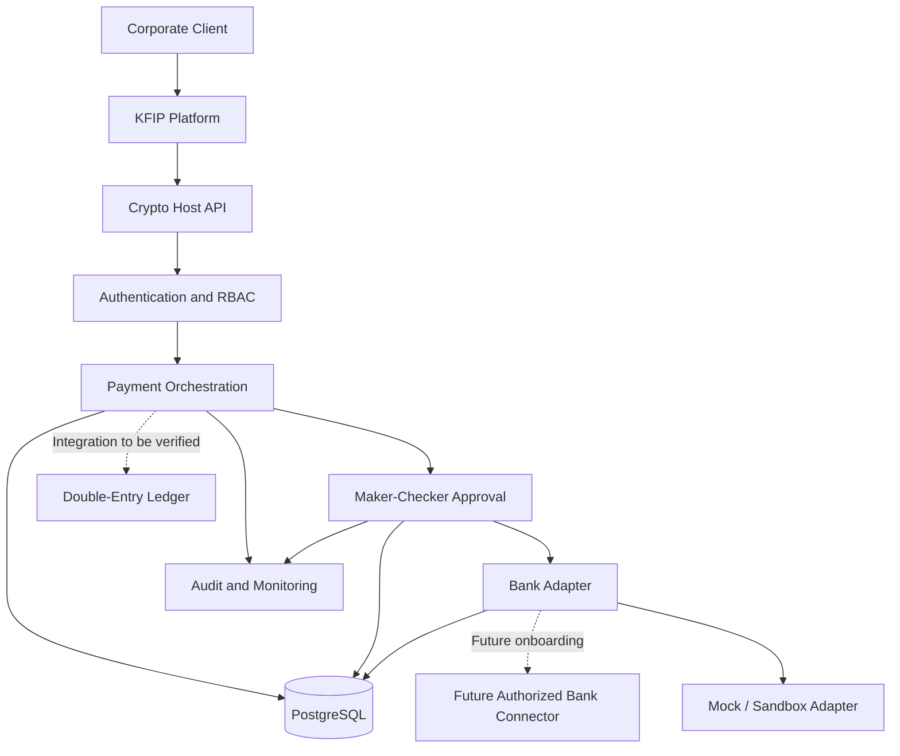
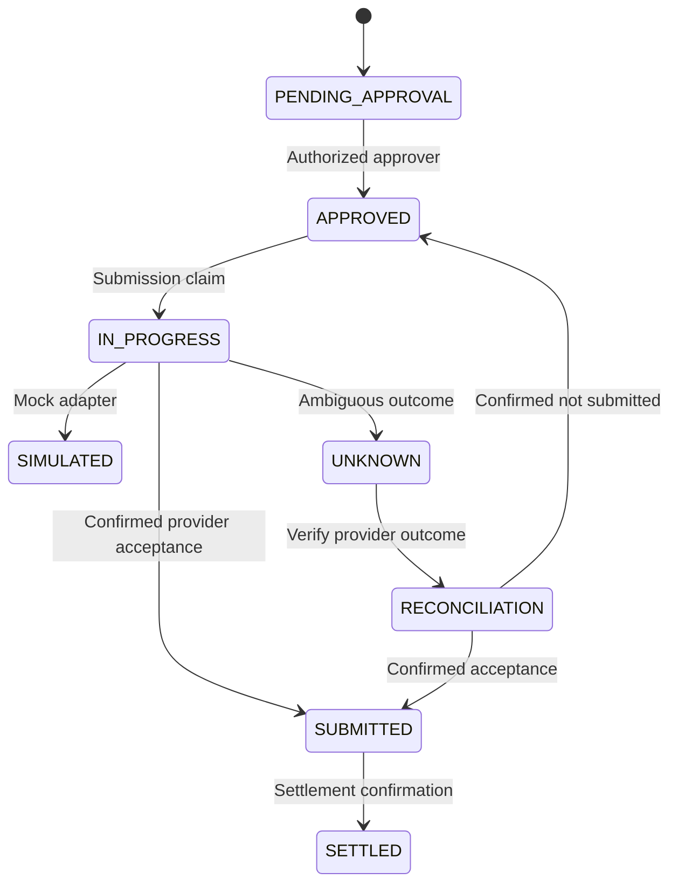

# 25. KFIP – Crypto Host Integration Architecture

**Document Status:** Architecture Proposal  
**Version:** 0.1.0  
**Project:** Kongali Financial Infrastructure Platform (KFIP)  
**Integration Component:** FAM Crypto Host

---

## 1. Purpose

This document defines the proposed integration architecture between
the Kongali Financial Infrastructure Platform (KFIP) and FAM Crypto Host.

KFIP provides the broader financial infrastructure architecture,
security framework, governance, and operational standards.

Crypto Host provides the application-level API and payment orchestration
implementation.

This document does not claim that production banking connectivity,
bank settlement, or regulated payment services are currently operational.

## 2. System Boundaries

| Component | Responsibility |
|---|---|
| KFIP | Overall platform architecture and governance |
| Crypto Host API | Authentication and payment orchestration |
| PostgreSQL | Application persistence |
| Bank Adapter | Bank connector abstraction |
| Mock Adapter | Simulated bank submission |
| Audit Service | Operational event recording |
| Security Layer | Authentication, encryption, and access control |
| Ledger Service | Double-entry accounting; implementation to be verified |

## 3. Proposed Integration Architecture

## 4. API Integration

The following endpoints are documented in the current Crypto Host API
project and must be verified against the deployed application.

| Method | Endpoint | Purpose |
|---|---|---|
| POST | /api/v1/auth/token | Obtain access token |
| GET | /api/v1/payments | List payments |
| POST | /api/v1/payments | Create payment |
| POST | /api/v1/payments/{payment_id}/approve | Approve payment |
| POST | /api/v1/payments/{payment_id}/submit | Submit payment |
| GET | /health | Health check |
| GET | /ready | Readiness check |

## 5. Payment Lifecycle

The states above describe the target lifecycle. Actual supported states
must be checked against the application models and adapter contracts.

A timeout or network error must not automatically be treated as a failed
financial transaction. The provider outcome must be queried or reconciled
before any retry that could create a duplicate transaction.

## 6. Security Architecture

QKD and PQC are complementary security technologies.

| Layer | Technology | Responsibility |
|---|---|---|
| Quantum key distribution | QKD | Secret key distribution |
| Post-quantum key establishment | ML-KEM | Key encapsulation |
| Post-quantum signatures | ML-DSA / SLH-DSA | Digital signatures |
| Symmetric encryption | AES-256 | Data encryption |
| Key management | KMS / HSM | Key lifecycle and protection |
| Transport security | TLS / mTLS | Protected communications |
| Application security | RBAC / MFA | Identity and authorization |
| Monitoring | Audit logs / SIEM | Security accountability |

QKD does not perform payment processing or transfer funds.
ML-KEM is not a digital signature algorithm.
QKD/PQC deployment remains subject to cryptographic design,
interoperability testing, and security validation.

## 7. Ledger and Reconciliation

The integration should eventually support:

- Balanced debit and credit journal entries.
- Immutable journal history.
- Reversal through compensating entries.
- Idempotent transaction processing.
- Provider reference tracking.
- Reconciliation of ambiguous submissions.
- Separation of payment acceptance from final settlement.

The existence and completeness of a production ledger and reconciliation
engine have not yet been verified.

## 8. Banking Connectivity

The current architecture must distinguish:

1. Mock adapter: simulated processing for development and testing.
2. Official sandbox: integration under an authorized provider sandbox.
3. Production connector: requires formal onboarding, credentials,
   technical specifications, security review, and UAT approval.

Bank Mandiri connectivity must not be represented as live until the
required official onboarding and acceptance evidence exists.

## 9. Deployment Architecture

The current backend project uses:

- FastAPI application.
- PostgreSQL database.
- SQLAlchemy ORM.
- Alembic migrations.
- Docker and Docker Compose.
- Static frontend served by the application.

Production deployment requires additional review of TLS termination,
secrets management, network isolation, backups, monitoring, logging,
access control, and disaster recovery.

## 10. Integration Testing

Minimum proposed test scenarios:

- Authentication and token expiration.
- Role-based access control.
- Maker cannot approve their own payment.
- Duplicate idempotency key handling.
- Beneficiary validation.
- Payment approval concurrency.
- Mock adapter submission.
- Ambiguous provider timeout.
- Reconciliation before retry.
- Audit event completeness.
- Ledger balance validation when ledger implementation is available.

## 11. Implementation Status

| Capability | Current assessment |
|---|---|
| FastAPI application | Present in source project |
| Authentication | Implemented; security review required |
| Payment creation | Implemented |
| Maker-checker approval | Implemented |
| Mock bank adapter | Present |
| Production bank integration | Not verified |
| Double-entry ledger | Not yet verified |
| Reconciliation engine | Not yet verified |
| Automated test suite | Requires expansion |
| QKD/PQC production deployment | Architecture/research stage |

## 12. Acceptance Criteria

The integration may progress beyond prototype status only when:

1. API contracts are documented and tested.
2. Authentication and authorization tests pass.
3. Payment lifecycle transitions are validated.
4. Idempotency and concurrency behavior are tested.
5. Audit records are complete and reviewable.
6. Ledger entries balance, if ledger is in scope.
7. Reconciliation handles ambiguous provider outcomes.
8. Bank connectivity is independently evidenced.
9. Security and deployment reviews are completed.

---

**Document classification:** Technical Architecture Proposal  
**Version:** 0.1.0
